# JantamaReviewer

雀魂の四人麻雀（半荘）を、AI（Mortal）の答えを見る前に自分の答えと理由を確定させてから検討するための、個人用の Windows アプリです。対局中は、小さなウィジェットで「迷った」瞬間と、局ごとの出来（〇△✕）を記録します。対局のあとは、mjai.ekyu.moe の検討結果を取り込み、記録と結びつけて見直します。見直しは、AI の答えを隠したまま自分の答えと理由を書く出題、間隔を空けた解き直し、半荘を通して見る画面、検索、検討ログ、週の集計でできます。v1 の機能のあと、答え合わせに、確定している役と近い役を出す「役の欄」を足しました。

## できること

画面の写真と GIF は、試験用のデータで撮っています。雀魂の画面は、プレイヤー名をぼかしたものだけを使っています。検討結果は、プレイヤー名を A〜D に置き換えた固定データです。撮り方は、写真が `scripts/readme-shots.mjs`、GIF が `scripts/readme-gifs.mjs` にあります（どちらも、アプリ自身の窓の中だけを撮ります。[開発](#開発)）。

### 対局中のウィジェット

<p>
  
  
</p>

<p>
  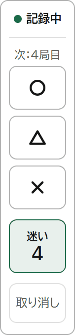
</p>

雀魂の窓の横に置く小さな窓で、常に手前に出ますが、クリックしても雀魂からフォーカスを奪いません。迷ったら、割り当てたボタン（既定はマウスのサイドボタン「戻る」。設定で変えられます）を押すと、その時刻と雀魂の窓のスクリーンショットを保存し（窓が見つからないときは画面全体）、局が終わったら〇△✕でその局の出来を付けます。縦長と横長があり、記録中かどうか、迷いの数、次の評価が何局目かが出ます（「取り消し」で最後の記録を取り消せます）。雀魂が管理者の権限で動いているときは、ボタンを拾う部分だけを、管理者で動く小さな補助プログラム（`jantama-helper.exe`）に分けてあり、設定ページで最初の 1 回だけ Windows の確認を許可すれば、以後は確認なしで起動します。

GIF は、ウィジェットの窓の中のボタンを、撮影の道具が押したものです。この撮影では、記録の命令（迷い・〇△✕・取り消し）を窓の通信の層で受け止めて、本体には通していません。スクリーンショットは、1 枚も撮っていません。

### 検討結果の取り込み


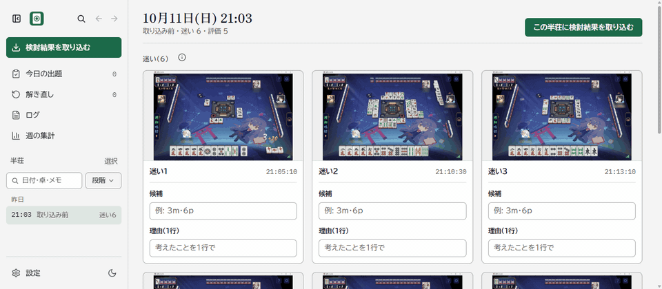

雀魂で牌譜リンクをコピーしてアプリの窓に戻ると、「この半荘を取り込みますか」と案内が出て、「mjai で検討する」を押すと、アプリの中の小さな窓で mjai.ekyu.moe が開きます（Submit と Cloudflare の確認は自分で押します）。結果が出ると窓は閉じ、結果の JSON を、取り込んだ時点の写しとして保存します（窓が使えないときは、結果の URL を貼るか、JSON ファイルを開いても取り込めます。GIF は、窓を使わずに URL を貼る形です）。取り込みのとき、迷いと評価のスクリーンショットから、局・残りの牌・自分の点数を Windows の日本語 OCR で読み、どの半荘のどの局かを決めます。迷いは、いちばん合う判断を「推定」として結びつけ、近い判断を「ほかの候補」に出し、読めないときは手で選びます。

### 半荘の一覧

<p>
  
</p>


左のサイドバーに、半荘を日付ごとに新しい順に並べ、各行に開始時刻・段階と Rating・迷いの数を出します（段階の印は卓の緑 1 色の濃さで、結果を取り込む前の半荘は「取り込み前」と出ます）。検索欄（日付・時刻・卓・段階・Rating など）と、「段階」の絞り込み（A 以下・B 以下・C 以下）で、半荘を絞れます。削除は、行の「…」から 1 件ずつ、「選択」から複数まとめてでき、確認のあと 8 秒間「元に戻す」が出ます（Ctrl+Z でも戻せます）。消した半荘は、アプリを閉じるまで戻せて、閉じたときに半荘のフォルダが Windows のごみ箱に移ります。

### 半荘の画面


見出しに日時・卓・段階・Rating（Mortal の Rating）が出て、題の下の 1 行に、AI 一致率（自分の判断のうち、AI の 1 位と同じだった割合）・類似度（Mortal の Rating と同じ値）・悪手率（実戦の行動の AI の確率が 5% より低かった判断（悪手）の割合。NAGA の悪手と同じ線）が、説明のアイコンつきで出ます（半荘全体の割合で、判断ごとの AI の答えではありません。迷いだけの設定でも出ます）。その下に迷いのカードが並びます。カードは、スクリーンショット（押すと大きく表示）、局・本場・巡目と迷いの種類、スクリーンショットから読んだ値、結びつけた判断、終局直後のメモの欄（次の節）、「この局面を解く」を持ちます。「推定」のものは「選び直す」や「ほかの候補」で付け替えられます（AI の候補や確率は出しません）。付け直しや選び直しは Ctrl+Z で取り消せ、テーマはサイドバーの下のボタンで、ライトとダークに切り替えられます。

### 終局直後のメモ

<p>
  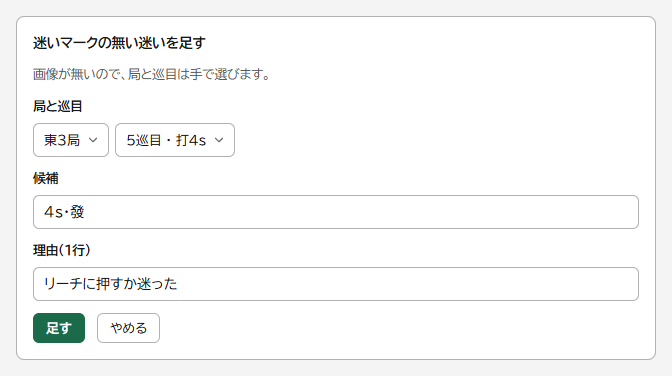
  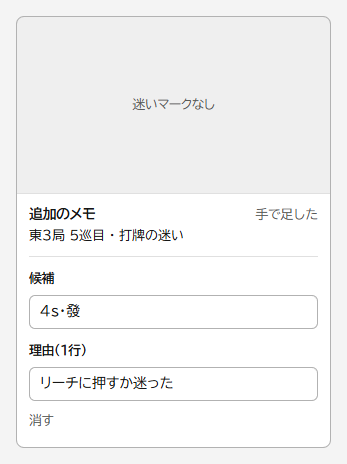
</p>

迷いのカードごとに、「候補」（例: `5p・2m`、`ポン・スルー`）と「理由（1 行）」を書き留められます。AI の答えを見る前に、そのとき考えたことを残すための欄です。局と巡目は聞きません（スクリーンショットの読み取りと結びつけで決まります）。迷いマークを押し忘れた迷いは、カードの並びの下の「迷いマークの無い迷いを足す」で、局と巡目を選んで足せます。書いたメモは、出題・解き直しの答え合わせのあと、「終局直後のメモ」として自分の答えの下に出ます（答える前は出ません）。半荘を通して見る画面の迷いの場面でも、答える前に書けます。

### 局の評価の表と MAKA の当てはめの見込み


半荘の画面の下の「局の評価」の表には、局ごとの結果・点・自分の〇△✕・AI 基準の段階（Mortal の Rating から付けた S+〜E）・MAKA（もう 1 つの検討 AI）の評価（任意で入力）・その局の迷いの札が並びます。札を押すと、その迷いのカードへ移ります。AI 基準と大きく食い違う局には旗が付きます。MAKA の評価を入れるたびに、AI 基準の段階を MAKA に近づける当てはめを合わせ直し、表の下に、いまの見込み（入っている MAKA の評価の局数と、「ぴったり」「±1 段階以内」の割合。1 半荘ずつ外して確かめた値）を出します。

### 局の結果の手

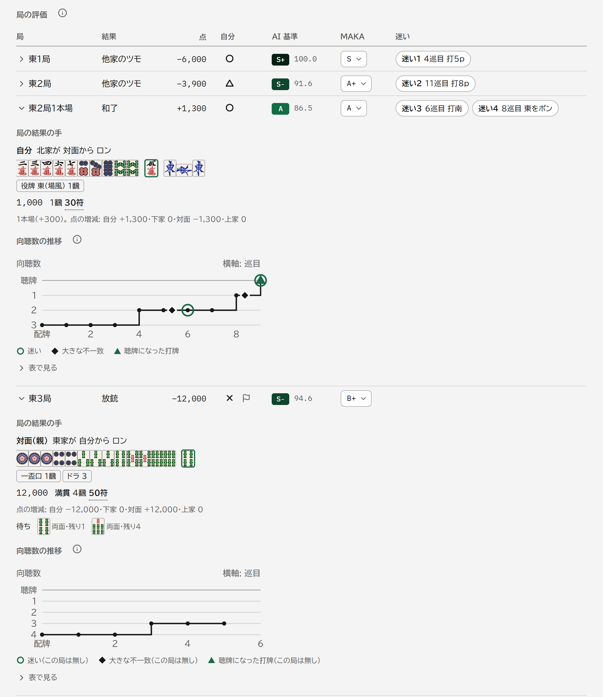

局の評価の表の局の名前（行の頭の矢印つきのボタン）を押すと、その局の結果の手が、行の下に開きます（表の形はそのままで、開かないかぎり増えません）。和了の局は、和了者・ツモかロン（だれから）・手牌（副露と和了牌つき）・役・飜・符・点数・点の増減（本場・供託も）を出します。他家のツモ・ロンの局も同じです。放銃した局は、相手の手牌と、和了牌を除いた手の待ち（待ちの形・残り枚数）も出ます。流局の局は、4 人の手牌を出し、牌山を取り切った流局では聴牌とノーテンを分けます。符の数にマウスを乗せる（キーボードで選ぶ）と、内訳が出ます。その下には、自分の向聴数の推移の折れ線が出ます（自分が切るたびの場面の向聴数。迷いは丸、悪手は菱形、聴牌になった打牌は三角。矢印キーで点を選ぶと内容が出て、「表で見る」で同じ数を表でも読めます）。

Mortal の結果には役・符・点数が入っていないので、牌譜から和了者の手を組み立てて、majiang-core で計算し直しています。固定データの和了 69 件で、役の名前・飜（ドラ・赤ドラ・裏ドラを含む）・符・点数・点の増減（本場・供託を含む）が、結果に付いている牌譜（split_logs）の和了と全部一致することを確かめています。

### 出題と答え合わせ

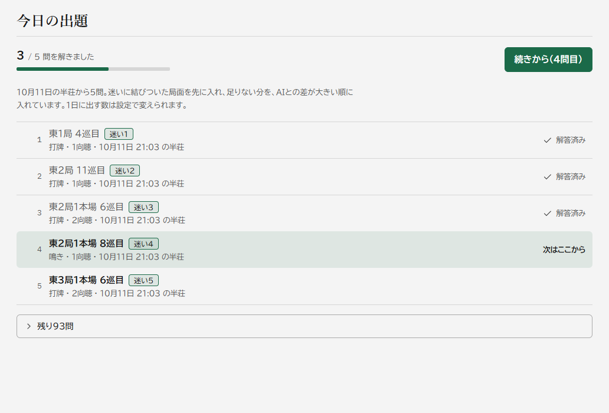

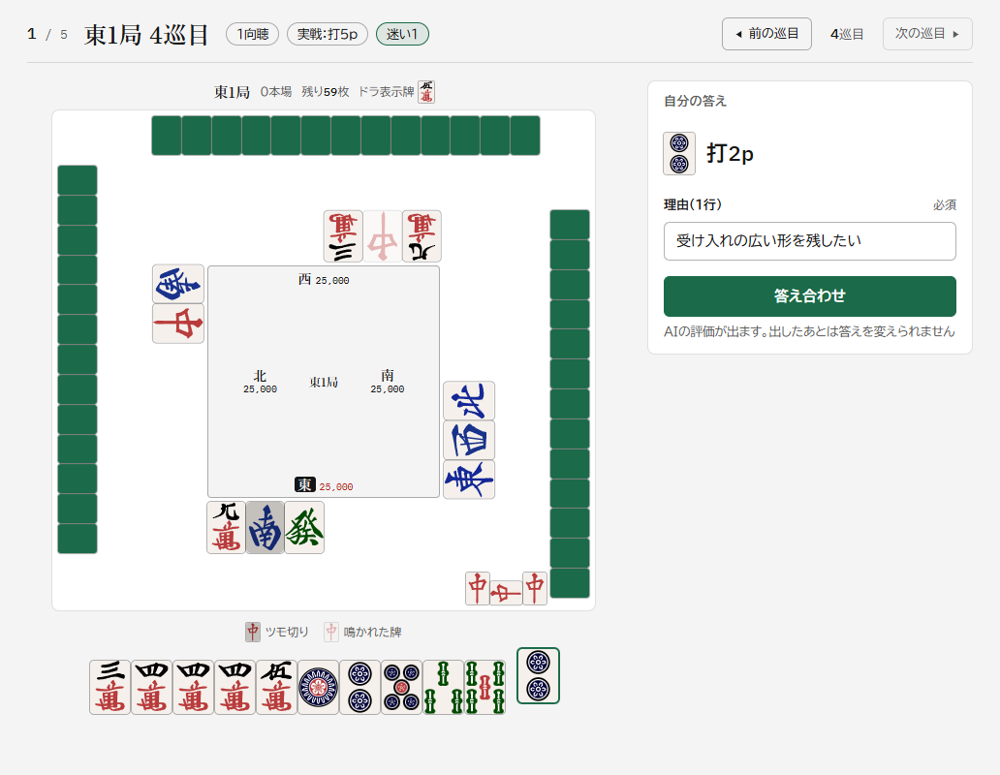

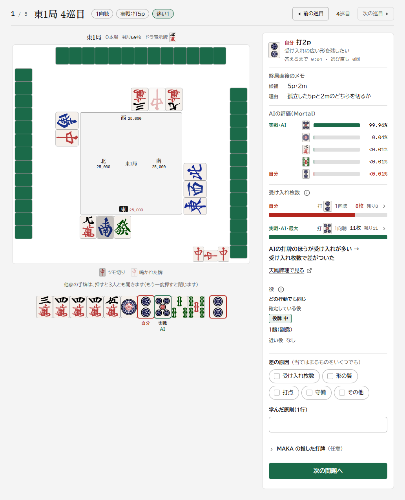

<p>
  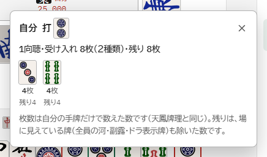
  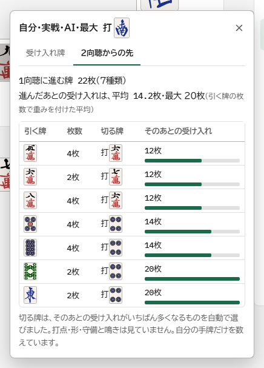
</p>

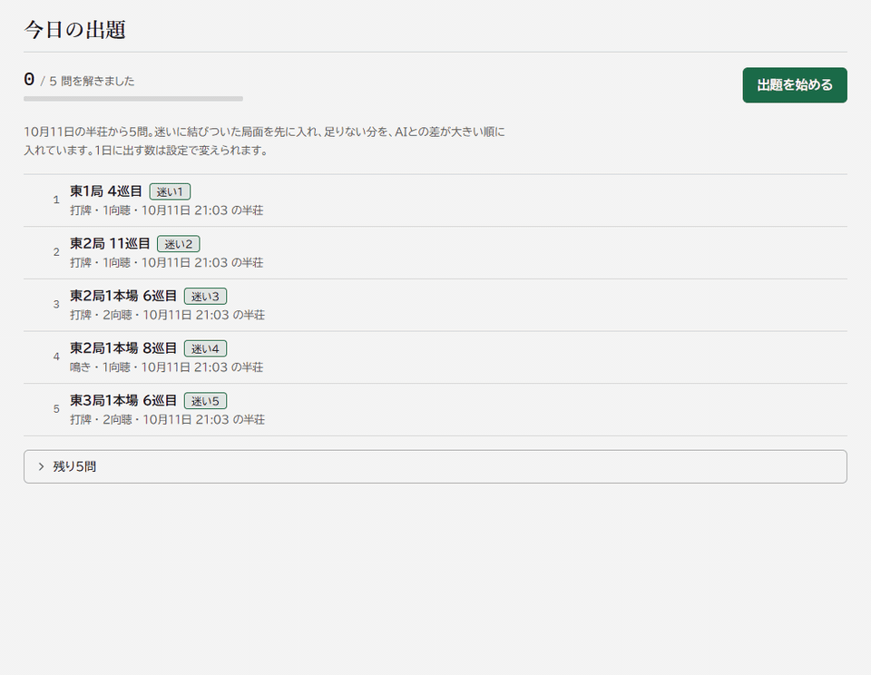

今日の出題には、迷いを結びつけた局面を先に入れ、足りない分を、AI が実戦の行動に付けた確率が 5% 未満の判断（悪手。NAGA の悪手と同じ線）を、確率の低い順に入れます（1 日に出す数は、設定で変えられます）。2〜3 巡前から盤面を戻して見られます。答えるまで、AI の候補・確率・順位は、画面にも出しません。牌（鳴きの判断はボタン）を選び、理由を 1 行書いて「答え合わせ」を押すと、AI の評価（Mortal）が、実戦と自分の答えに印を付けて出ます。

打牌の判断では、自分・実戦・AI・最大の受け入れ枚数を、向聴数と並べて出します（手牌だけで数えた枚数と、場に見えている牌を除いた残り）。行を押すと、受け入れ牌ごとの枚数と残りが小窓で開きます。打牌のあとが 2 向聴のときは、「2向聴からの先」も出ます。1 向聴に進む牌ごとに、そのあと受け入れが最大になる打牌と枚数を並べ、平均と最大を出します。向聴数が違う打牌どうしは、枚数では比べられないので、「向聴数で差がついた」と出します。そのあと、差の原因（受け入れ枚数・形の質・打点・守備・その他。いくつでも）と、学んだ原則（1 行）を付け、MAKA が推した打牌も任意で入れられます。

### 役の欄

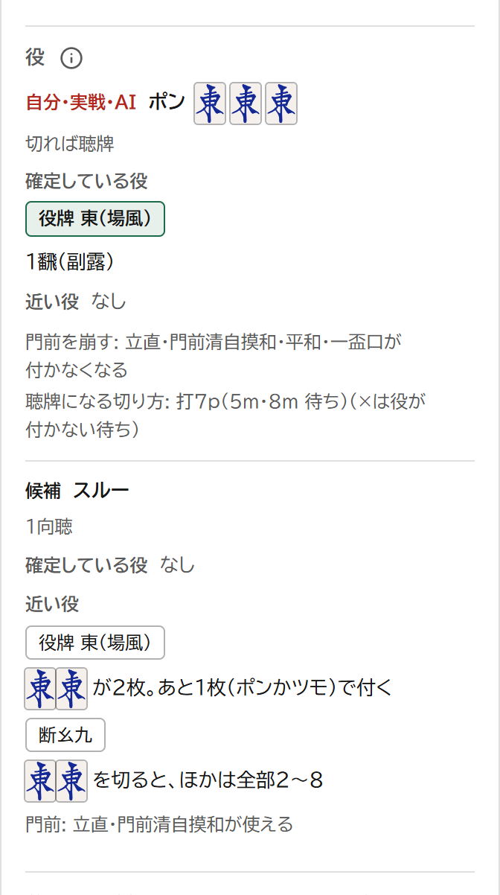

答え合わせのあと、受け入れ枚数の欄の下に、欄「役」が出ます（出題・解き直し・半荘を通して見る画面で同じです）。比べる行動（自分・実戦・AI。鳴きの判断はチー・ポン・スルー）ごとに、その行動のあとの手の、確定している役と近い役、役無しの警告を出します。

- 確定している役: どう和了っても付く役。聴牌なら、どの待ちでも付く役です（一部の待ちだけで付く役は「待ち 南 のとき」のように分けます）。立直・門前清自摸和・ドラは数えません。
- 近い役: あと 3 枚以内で、いちばん早い和了より 1 枚遠回りまでで付く役です。役牌・断幺九・混一色（清一色を含む）・一気通貫・三色同順に限り、足りない牌か切る牌を添えます（1 つの行動に 2 行まで）。
- 役無しの警告: 副露して役が無い手は、札「役無し」と太字の文で出します。聴牌しても待ちに役が付かないときは「和了れない」と出します。門前でダマだと役が無い待ちは、薄い注にとどめます。
- 行動の中身が全部同じなら、1 つにまとめて「どの行動でも同じ」と出します。答える前には出ません。

役の判定は、エンジンの自前のコードです（雀魂の規則: 喰いタンあり・後付けあり・赤ドラあり）。正しさは、Python の mahjong と kobalab の majiang-core（MIT）の 2 つの正解表と照らして確かめています（役の欄では、majiang-core は試験だけで使います。次の「待ちと打点」の点数の計算には、実行時にも使います）。

### 待ちと打点・待ちの形・符の内訳

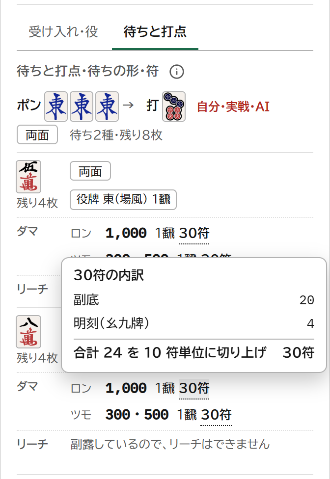

答え合わせのあと、聴牌になる行動がある場面だけ、既定のタブ「受け入れ・役」のとなりに、タブ「待ちと打点」が出ます（出題・解き直し・半荘を通して見る画面で同じです。聴牌にならない場面には、タブは出ません）。聴牌になる行動は、比べる打牌（自分・実戦・AI）、スルーのままの聴牌、チー・ポンのあとに切る牌、リーチの判断（聴牌になる切り方すべて）です。タブは、← →・Home・End で選べます。答える前には出ません。

- 待ち牌ごとの行: 待ち（牌と、見えている牌と自分の手牌を除いた残り枚数）、待ちの形（両面・嵌張・辺張・双碰・単騎。3 種類以上の待ちは、表の見出しに「多面張」）、どちらでも付く役、ダマとリーチ（門前だけ）それぞれの、ロンとツモの飜・符・点数を並べます。ロンできない待ち（役が無い）は「役なし（ロンできない）」、自分の河にある牌の待ちは「（フリテン）」と出ます。待ちも点も同じ打牌は、1 つの表にまとめます。
- 符は「40符」のように数だけ出し、マウスを乗せる（キーボードで選ぶ）と、内訳（副底・門前ロン・暗刻・明刻・雀頭・待ちなど）が重なって出ます。
- 数えないもの: 裏ドラ・一発・海底などの和了の状況で決まるもの、和了牌が赤のときの赤ドラ（手牌の中の赤は数えます）。点数は、本場・供託を除いた値で、雀魂の規則（切り上げ満貫なし・喰いタンあり・赤ドラ各 1 枚）です。

点数の計算は、kobalab の majiang-core（MIT。版を 1.4.1 に固定し、エンジンの 1 つのファイルの中だけで読み込みます）です。符の内訳は、Python の mahjong の `fu_details` の数え方をエンジンに移したものです（実行時に Python は使いません）。どちらも、Python の mahjong で作った正解表（実戦の聴牌になる全部の待ち・乱数の和了形）と、牌譜の和了 69 件の点の増減（本場・供託を含む）に、全部照らして確かめています。

### 守備の目安

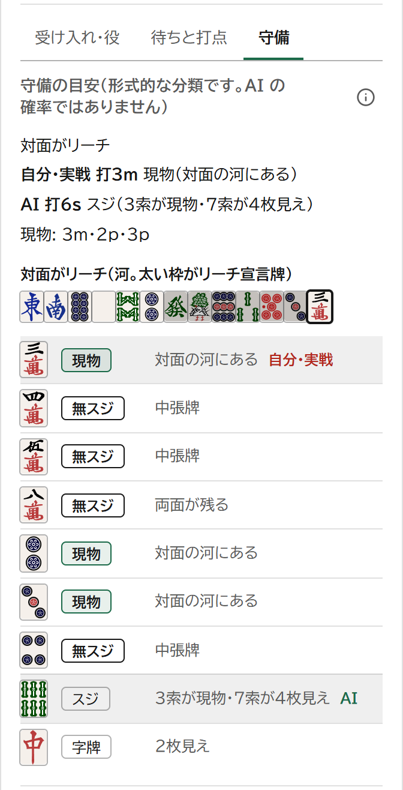

答え合わせのあと、他家のリーチがある場面と、副露の気配の 1 行を出す他家がいる場面（下の「副露の気配」）だけ、タブ「守備」が出ます（出題・解き直し・半荘を通して見る画面で同じです。どちらも無い場面には、タブは出ません）。切れる牌（打牌とリーチの判断は手牌とツモ牌、鳴きの判断は、チー・ポンのあとに切れる牌）ごとに、リーチした人ごとの分類を 1 語と短い補足で出し、比べる打牌（自分・実戦・AI）の行には印が付きます。リーチした人が 2 人以上のときは、人ごとの欄を、宣言した順に並べます。答える前には出ません。

形式的な分類で、AI（Mortal）の放銃の確率ではありません。リーチした人の河と、場に見えている牌の数だけで、牌を 5 つに分けます。

- 現物: その人の河にある牌と、その人のリーチのあとに通った牌。
- スジ: 両面で待たれる形が、現物のスジで消えている牌（嵌張・辺張・単騎・双碰は残ります）。
- 壁: 両面の形に要る牌が 4 枚見えている牌。
- 字牌: 現物でない字牌（見えている枚数つき）。
- 無スジ: 両面で待たれる形が残っている牌。

リーチしていない他家のうち、副露が多い人と染め手の気配の人には、牌ごとの分類は出さず、気配の 1 行だけを、リーチの人の欄のあとに出します（「副露の気配」。リーチの人がいなくても、この 1 行の人がいれば、タブ「守備」が出ます。その場合は、行と断りだけの欄です）。

- 対象: 副露（チー・ポン・大明槓・加槓。暗槓は数えません）が 2 つ以上の人か、染め手の気配の人（副露が、すべて同じ 1 色の数牌と字牌だけで、その色を含む副露が 1 つ以上あり、河にその色が 1 枚以下）。リーチした人は、対象にしません。
- 行: 「下家: 2副露・索子の染め手の気配・役牌の刻子（發）」のように、副露の数・染め手の色・役牌の刻子（場風・自風・白發中のポン・カン）を書きます（染め手と役牌は、あるときだけ）。

ドラ待ち・巡目は見ていません。分類の順は、固定データのリーチの場面（打牌の判断 133 場面）で、majiang-ai（kobalab。MIT）の危険度の数値の順と照らして、大きく食い違わないことを確かめています（現物の数値は全部 0。分類ごとの平均は、現物 0.00 < 壁 1.07 < 字牌 1.80 < スジ 3.24 < 無スジ 6.64。壁は固定データに 3 件しかなく、実戦では未確認です）。majiang-ai は、試験だけで使う開発用の依存で、アプリには入りません。

### 他家の手牌と、聴牌になった巡目

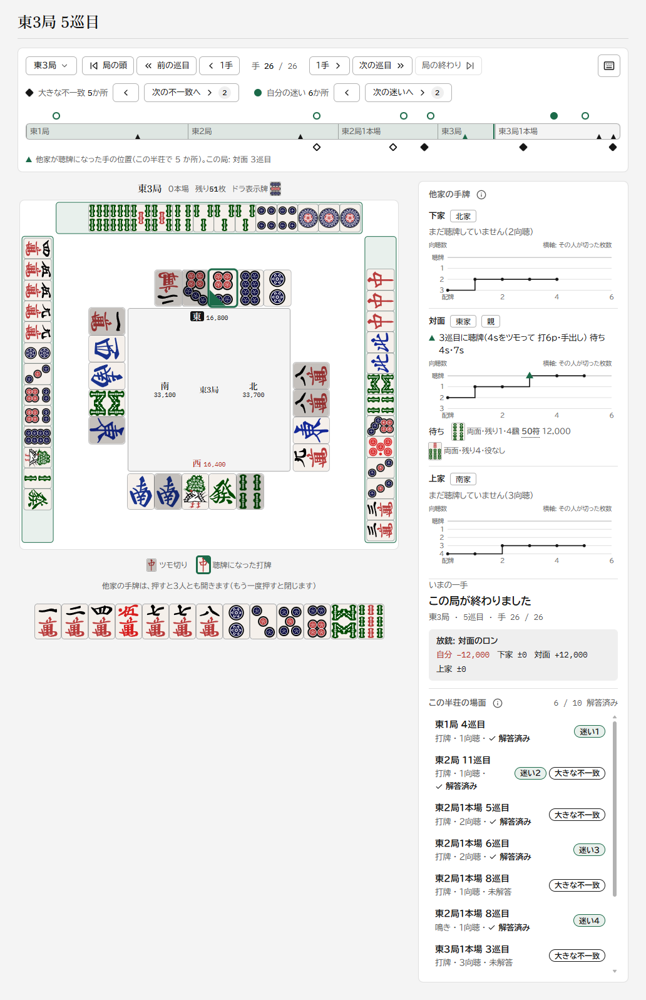

盤面の他家の席に、手牌が裏向きで並びます（対面は河の上、上家と下家は河の外側。ツモ牌は少し離れます）。どれか 1 人の手牌（河ではありません）を押す（クリック・Enter・Space）と、3 人分が表向きに開き、もう一度押すと閉じます。開いた状態は、手を進めても残り、画面を離れると閉じに戻ります。通して見る画面では、答える場面（迷い・悪手）でなければ、いつでも開けます。答える場面と、出題・解き直しの画面では、答えるまで押せず、表の牌は画面の中にも出しません。

開いているあいだだけ、次のものが出ます（閉じているときは、どれも出ません）。

- 「他家の手牌」の欄（通して見る画面は右の欄の上、答えたあとの場面は答えの欄の上）: 人ごとに、席・風・親・リーチの札、聴牌になった巡目の 1 行（「7巡目に聴牌（3pをチーして 打西・手出し） 待ち 5m・8m」。まだなら「まだ聴牌していません（2向聴）」）、その人が切るたびの向聴数の折れ線（▲ が聴牌になった打牌。矢印キーで点を選ぶと値が出ます）、聴牌している人の待ち（待ちの形・残り枚数・飜・符・点数）。牌の並びは、盤面だけに出ます。
- 河: 聴牌になった打牌に、枠（右上の三角つき）が付きます。
- 位置の帯: 他家が聴牌になった手の目盛りが付き、半荘の中の数と、いまの局の分が、帯の下に書かれます。

「N巡目」は、その人が N 枚目の牌を切ったときです。聴牌になった打牌は、その人の向聴数が 0 でなかった手から 0 になった打牌（鳴いて聴牌になったときは、鳴いたあとの打牌）で、聴牌を崩して、また聴牌になったときは、聴牌の区間ごとの最初の打牌に印が付きます。固定データの 7 半荘（印 110 か所）で、印の位置・経路・待ち・折れ線の点を、別の計算と照らして確かめています。Mortal の結果には他家の手牌は入っていないので、牌譜から、全員の手牌を追い直しています。

### 解き直し

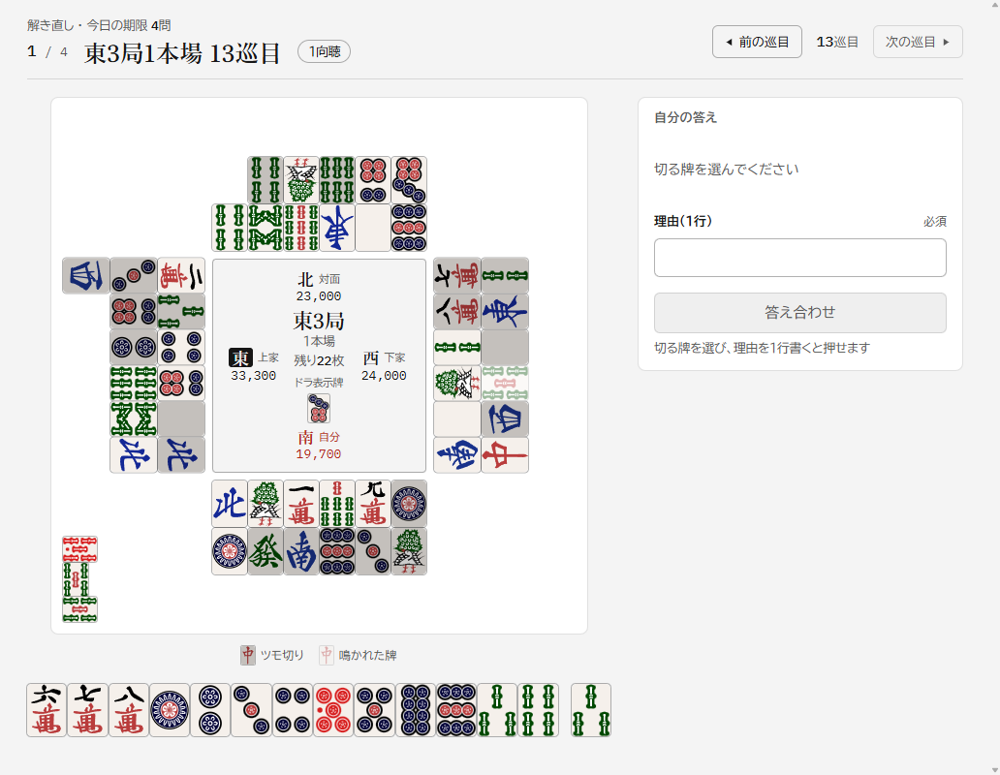

答えた問題は、1 → 3 → 7 → 14 → 30 → 60 日の間隔で、解き直しに出ます（出題で答えた問題は、正解でも不正解でも 1 日後に出ます）。間違えると 1 日に戻り、正解でも、答えを選び直した問題は、間隔を伸ばさず、同じ間隔でもう一度出ます。解き直しでは、答え合わせまで、実戦の行動も AI の答えも出しません。理由（1 行）は、解き直しでも必須です。

### 半荘を通して見る

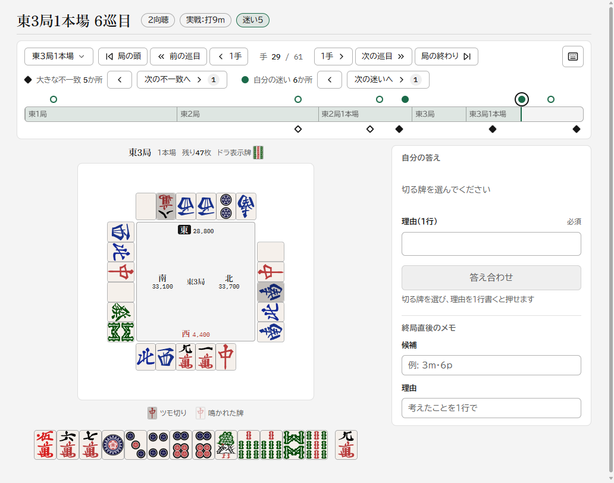

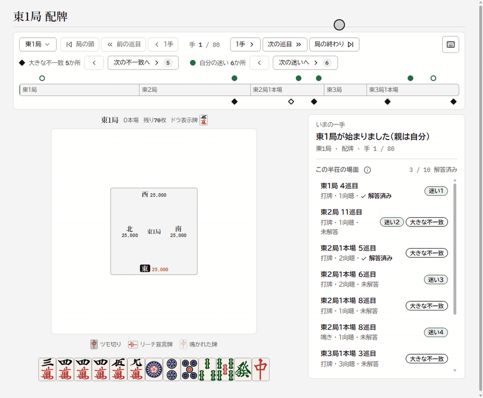

取り込んだ半荘を、卓の配置の盤面で、1 手（全員の打牌と鳴きの 1 つ）ずつ再生します。迷いを結びつけた場面と、悪手の場面は、位置の帯（迷いは上の丸、悪手は下のひし形）と場面の一覧に出て、押すとその場面へ飛びます。場面に着くと、出題と同じ形で答えられます（答える前は、AI の情報を出しません）。半荘の画面の「この半荘を通して見る」と、迷いのカードの「この局面を解く」から開きます。

キーの既定は、`,` `.` で 1 手戻る・進む、← → で前・次の自分の判断、↑ ↓ で前・次の悪手、Shift+↑ ↓ で前・次の迷い、Shift+← → で前・次の局、Home・End で局の頭・終わりです。キーボードのアイコンから、割り当てを変えられます。

### 検索

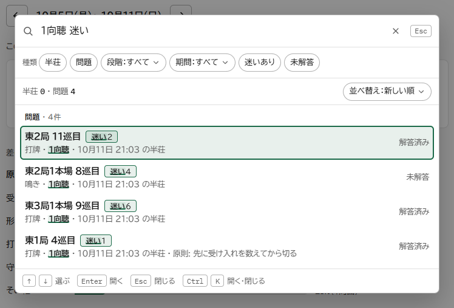

Ctrl+K（サイドバーの虫眼鏡）で開く重ね表示で、半荘と問題を探します。半荘は日付・時刻・卓・段階・Rating・メモ・局の名前で、問題は局・巡目・種類・向聴数・迷い・学んだ原則・解答の状態などで探せます。語は空白で区切り、すべてに当たるものだけが出ます。種類・段階・期間・迷いあり・未解答で絞り込み、並べ方も替えられます。矢印キーで選び、Enter で開きます。

### 検討ログ

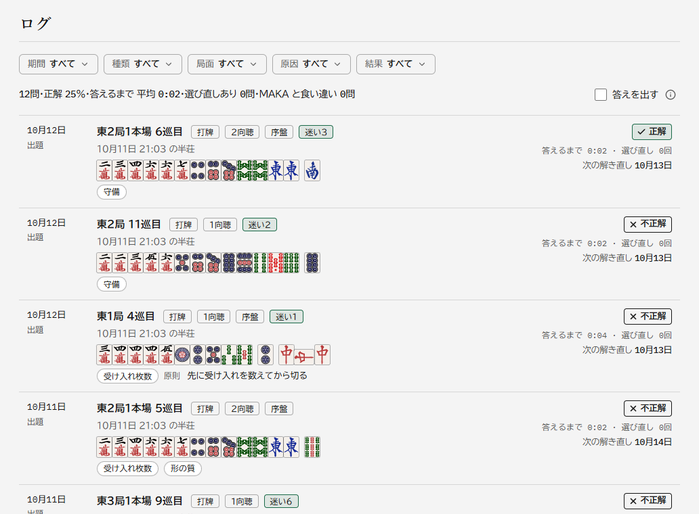

答え合わせをした局面を、1 行ずつ並べます。期間（今週・先週・30 日・すべて）・種類・局面（向聴数・鳴き・押し引き・序盤）・原因・結果（正解・不正解）で絞り込めます。上に、問題の数・正解の割合・答えるまでの平均・選び直しの数・MAKA と食い違った数が出ます。行には、その場面の手牌とツモの小さな牌と、答えるまでの時間、次の解き直しの日も出ます。自分・実戦・AI の 1 位の欄は、「答えを出す」を入れたときだけ出します（あとの解き直しで、答えが見えてしまわないように、起動し直したら切に戻ります）。行を押すと、保存した答えで開きます。

### 週の集計

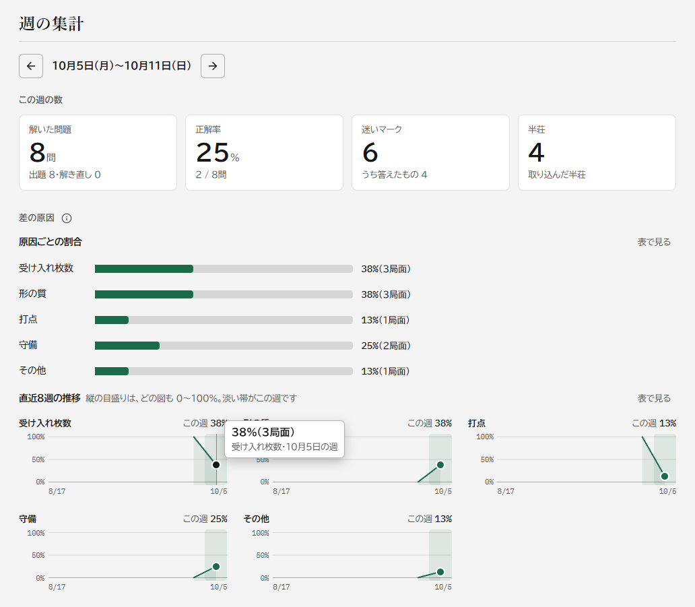

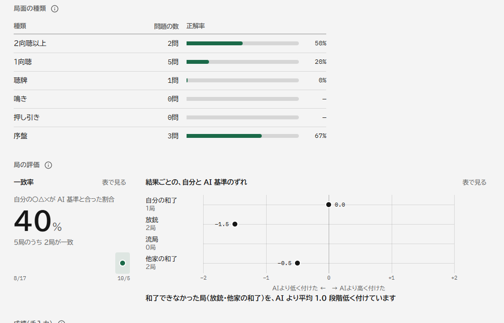

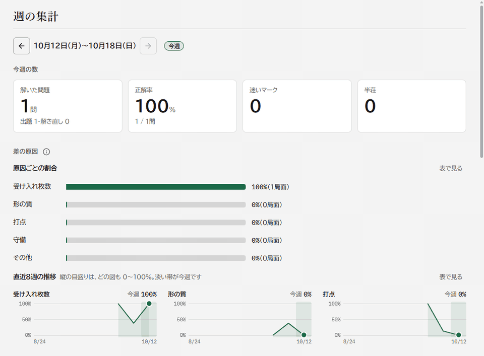

週（月曜から日曜）ごとに、差の原因の割合と直近 8 週の推移、局面の種類ごとの問題の数と正解率、局の自己評価（〇△✕）と AI 基準の一致率、結果（和了・放銃・流局・他家の和了）ごとのずれを見ます。成績（4 位率・放銃率・平均順位・和了率・副露率・立直率）は、雀魂の成績の画面を見て手で入れ、来週の重点（任意、1〜3 行）も書けます。手入力の成績の下には、別の表「取り込んだ半荘から数えた値（参考）」が出て、その週に始めた取り込み済みの半荘の記録だけから数えた、4 位率・放銃率・平均順位・和了率・副露率・立直率・平均和了点と、AI 一致率・類似度・悪手率（半荘のページの見出しと同じ数を、その週の判断をまとめて数えたもの。自分の〇△✕ の一致率とは別の数です）を、もとの数と半荘ごとの内訳つきで見られます（雀魂の成績の画面は読まず、数え方も雀魂と同じとは限らないので、手入力の値とは合わないことがあります。手入力の成績は、そのまま残ります）。どの図も、点に合わせると数字が出て、「表で見る」で表にもできます。

### 記録の書き出し

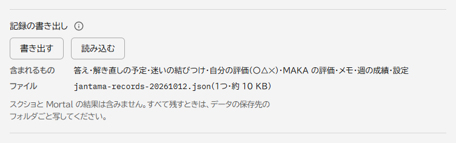

設定ページの「記録の書き出し」で、答え・解き直しの予定・迷いの結びつけ・自分の評価（〇△✕）・MAKA の評価・メモ・週の成績・設定を、記録だけの 1 つの JSON にします。スクリーンショットと Mortal の結果は含まれません（すべて残すときは、データの保存先のフォルダごと写してください）。保存先と窓の位置は入れません。読み込みは、ファイルを確かめてから、いまの記録を置き換えます。保存先に無い半荘の記録は取っておき、その半荘のフォルダが現れたときに付けます。

### 細い窓

<p>
  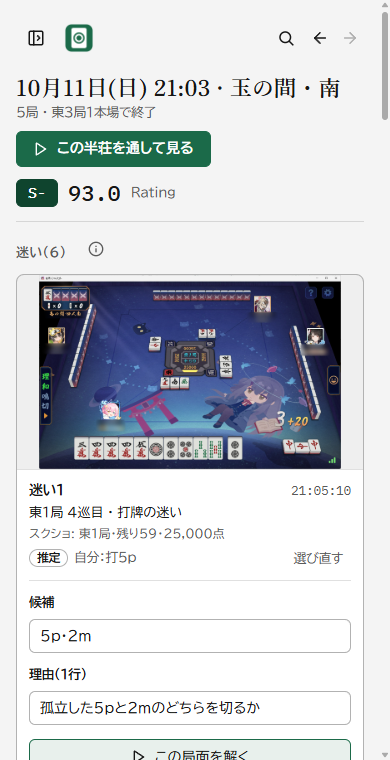
  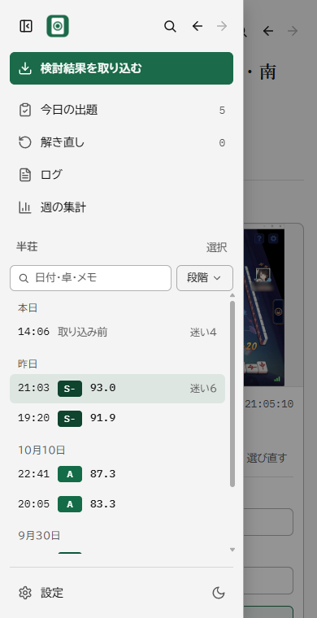
</p>

窓の幅が 640px より狭いときは、サイドバーを引き出しにして、本文を 1 列にします。

### 設定


迷いマークのボタンの登録（押したマウスのボタンやキーをそのまま覚えます）とテスト、管理者の補助プログラムの設定と解除、ウィジェットの形、音、データの保存先、記録の書き出し、雀魂の窓を探す語、1 日に出す数、AI の 1 位と違う判断も飛び先に入れるか、ドラを目立たせるかを決めます。変えるとその場で反映して保存します（保存ボタンはありません）。保存先の既定は `%USERPROFILE%\JantamaReviewerData` です。写真は、補助プログラムが動いているときの表示で、保存先は例のパスに置き換えています。

## 雀魂の規約について

雀魂の規約に触れないよう、次の線引きを守って作っています。これは作者が引いた線引きで、運営者の承認を受けたものではありません。

- 対局中に、ゲームの画面やデータを機械で読み取りません。スクリーンショットは保存するだけです。画像の文字認識（局・残りの牌・点数の読み取り）は、対局後の取り込みのときにしか行いません。
- ゲームの中でスクリプトや拡張機能を動かしません。ゲームの通信を中継せず、ゲームのプロセスにも触れません。
- 対局中に、画面や情報を外部（人や AI）に送りません。
- 対局中に動くのはウィジェットだけです。ウィジェットは、ユーザーの操作（マウスのボタン、クリック）を受けたときに、画面の保存と記録の追記だけを行います。ボタンを拾う補助プログラムは、入力を本体に知らせるだけで、画面・通信・ファイルは扱いません。
- 牌譜リンクを mjai.ekyu.moe に渡すのは、対局後にユーザー自身が行います。Submit も Cloudflare の確認も、自分で押します。アプリが自動で送ることはありません。
- アプリ自身が行う通信は、mjai.ekyu.moe の結果の JSON の取得だけです。mjai の小さな窓は、サイトを開いて見せるだけで、押すのはユーザーです。

このうち、ゲームのプロセスに触れないこと、雀魂のドメインと通信しないこと、対局中に画面を読まないこと、ウィジェットの操作で外へ送らないことは、ソースの静的検査と単体テスト（`apps/desktop/src-tauri/tests/safety.rs` など）で確かめています。基準は `ACCEPTANCE.md` の「安全」の項にあります。

## 動く環境

- Windows 10 / 11（開発と確認は Windows 11 で行っています）
- Microsoft Edge WebView2 ランタイム（画面の表示に使います）
- Windows の日本語の文字認識（OCR）。取り込みのとき、スクリーンショットから局と点数を読むのに使います。入っていなくても取り込みはできますが、迷いの結びつけを、すべて手で選ぶことになります。
- Mac（0.2.1 から）: Apple Silicon の Mac、macOS 14 以降。Mac で使えるのは、検討の画面（半荘の一覧・半荘の画面・出題・解き直し・半荘を通して見る・検索・ログ・週の集計・書き出しと読み込み・同期・設定）です。ウィジェット・迷いマークのボタン・スクリーンショット・取り込みのときの文字認識は、まだ Mac では動きません。対局と取り込みは Windows で行い、記録は同期で Mac に届けます（スクリーンショットは同期しません）。

## 入れ方

GitHub の [Releases](https://github.com/terasaki-8910/JantamaReviewer/releases/latest) から入れます。入れたあとは、起動したときに新しい版を知らせます（「今すぐ入れ直す」で入れ直します。設定の「更新を確かめる」でも確かめられます）。

### Windows

`JantamaReviewer_<版>_x64-setup.exe` を落として動かします。今のユーザーにだけ入れるので、管理者の確認はありません。本体と補助プログラムが同じフォルダに入ります。インストーラーにはコードの署名が無いので、「Windows によって PC が保護されました」と出たら、「詳細情報」→「実行」を押します。

### Mac で使う

1. `JantamaReviewer_<版>_aarch64.dmg` を落として開き、`JantamaReviewer` を「アプリケーション」のフォルダに引きずって入れます。
2. このアプリは Apple の公証を受けていない（ad-hoc の署名だけの）ので、そのまま開くと「壊れているため開けません」と出ます。最初の 1 回だけ、ターミナルで次を実行してから開きます。

   ```sh
   xattr -cr /Applications/JantamaReviewer.app
   ```

3. 開くと検討画面が出ます。Windows の記録を見るには、設定の同期の欄に、Windows で使っている同期先の DB の URL とトークンを入れます（トークンは Mac のキーチェーンに入ります）。
4. アプリ内の更新で入れた版には、`xattr` は要りません。署名が版ごとに変わるので、更新のあと、キーチェーンの確認（同期のトークンを使ってよいか）が出ることがあります。そのときは「常に許可」を押します。

保存先の既定は `~/JantamaReviewerData`、設定のファイルは `~/Library/Application Support/io.github.terasaki-8910.jantama-reviewer/` です。

## 作り方

ソースから作るときに必要なものは、次のとおりです（Mac で作る手順は [analysis/mac/appendix/mac-steps.md](analysis/mac/appendix/mac-steps.md) の A にあります）。

- Node.js（動作確認は v25.2.1）と pnpm 11（`packageManager` は `pnpm@11.9.0`）
- Rust 1.90 以上（Windows では MSVC のツールチェーン。Visual Studio の C++ ビルドツールが要ります）
- Microsoft Edge WebView2 ランタイム

```powershell
git clone https://github.com/terasaki-8910/JantamaReviewer.git
cd JantamaReviewer
pnpm install
pnpm --filter @jantama/desktop tauri build --no-bundle
```

`apps\desktop\src-tauri\target\release\` に、本体の `jantama-reviewer.exe` と、管理者の補助プログラムの `jantama-helper.exe` ができます。2 つは同じフォルダに置いておきます。`jantama-reviewer.exe` を起動すると、ウィジェットが出ます。検討画面は、ウィジェットを右クリックして「検討画面を開く」か、タスクトレイのアイコンから開きます。

雀魂が管理者の権限で動いていると、その窓が前面にある間、普通の権限のアプリにはマウスのボタンが届きません。その場合は、設定ページの「管理者の補助プログラムを設定する」を押して、Windows の確認で「はい」を選びます。最初の 1 回だけです。補助プログラムは Program Files に写され、確認なしで起動するタスクが登録されます。「設定を解除する」を押すと、その写しとタスクが消えます。補助プログラムを設定していなくても、管理者ではない窓の上なら、本体だけで動きます。

## 使い方

1. 対局中: 迷ったら、割り当てたボタンを押します。局が終わったら、ウィジェットで〇△✕を付けます。
2. 対局のあと: 雀魂で牌譜を共有（コピー）して、アプリの窓に戻ります。「この半荘を取り込みますか」で「取り込む」を押し、「mjai で検討する」で開く小さな窓で Submit を押します。mjai の設定は、サイトの既定のまま（Mortal 4.1b balanced・温度は既定）にします。毎回同じ設定にすると、結果を比べられます。
3. 取り込みが終わったら、半荘の画面を開きます。迷いのカードの結びつけを確かめ（違っていたら選び直します）、迷いごとに、候補と理由のメモを書き留めます（押し忘れた迷いは「迷いマークの無い迷いを足す」で足します）。局の評価の表で、自分の〇△✕と AI 基準を見比べ、必要なら MAKA の評価を入れます。
4. 毎日: サイドバーの「今日の出題」を開いて、AI の答えを見る前に、自分の答えと理由を書きます。答え合わせのあと、差の原因と学んだ原則を付けます。期限の来た問題は、「解き直し」に出ます。
5. 見直したいとき: 「この半荘を通して見る」で半荘を通して見て、迷いと悪手の場面へ飛びます。「ログ」で答えた問題を絞り込み、Ctrl+K の検索で、半荘や問題を探します。週に 1 回、「週の集計」で、差の原因・局面の種類・自己評価のずれを見て、成績と来週の重点を書きます。
6. 記録を残すとき・写すとき: 設定ページの「記録の書き出し」で、記録だけの JSON を書き出します。

データは、半荘ごとのフォルダに保存します（既定は `%USERPROFILE%\JantamaReviewerData\games\<開始時刻>\`）。ウィジェットの記録（`events.jsonl`。追記式）、迷いと評価のスクリーンショット（`marks\`・`ratings\`）、取り込んだ結果（`report.json`）、文字認識の写し（`ocr.json`）、結びつけ（`links.json`）、自分の評価の付け直し（`self-ratings.json`）、MAKA の評価（`maka.json`）、終局直後のメモ（`memos.json`）、解決した局面（`resolved.json`）、NAGA の結果の URL（`naga.json`）が入ります。答え・解き直しの予定・今日の出題・週の成績は、保存先の直下の `study.sqlite` に入ります。保存先は、Git のリポジトリの外に限ります。

## 開発

構成は、Tauri v2 のデスクトップアプリ（`apps/desktop`。画面は React と TypeScript、`apps/desktop/src-tauri` は Rust の本体・`input`・`helper`・`ocr`）と、牌譜の再生や評価の計算を受け持つ TypeScript の `packages/engine` です。

```powershell
pnpm install          # 依存の取得
pnpm test             # 全 vitest と cargo test --workspace
pnpm lint             # eslint・stylelint・tsc・cargo clippy・cargo fmt
pnpm dev              # tauri dev（先に pnpm build:helper で補助プログラムを作っておく）
pnpm build:debug      # デバッグビルド（本体と補助プログラム）
```

- 守備の目安の試験（`packages/engine/tests/danger.test.ts`）は、majiang-ai の危険度の数値（`devDependencies`。配らない）と、分類の順を照らします。
- 待ちと打点の正解表（`packages/engine/tests/fixtures/win-value-oracle.json`）は、`packages/engine` で `WIN_VALUE_DUMP=1 pnpm exec vitest run tests/win-value-dump.test.ts` を動かしたあと、`tests/fixtures` で `uv run --offline --with mahjong python generate_win_value.py` を動かすと、作り直せます。
- 実機の入力を通す手動の試験は、`pnpm test:hook`（本物のフックに入力を注入）と `pnpm test:task`（本物のタスクスケジューラ）です。`pnpm test` には含めていません。
- 試しに動かすときは、環境変数 `JANTAMA_CONFIG_DIR` に一時フォルダを指定し、そこの `settings.json` の `data_dir` も一時フォルダにします。本物のデータには触れません。
- README の画面写真は、`node scripts/readme-shots.mjs <迷いマークの画像のフォルダ>` で、作った実行ファイルから撮り直せます（一時フォルダだけを使います）。GIF は、`node scripts/readme-gifs.mjs <迷いマークの画像のフォルダ>` で録り直せます（ffmpeg が PATH に要ります）。どちらも、アプリ自身の窓を WebView2 の遠隔デバッグ（CDP）で操作して撮るので、画面全体やほかのアプリは撮りません。ウィジェットの GIF では、迷い・〇△✕・取り消しの命令を窓の通信の層で受け止め、本体には通しません。
- 仕様は [SPEC.md](SPEC.md)、受け入れ基準は [ACCEPTANCE.md](ACCEPTANCE.md)、決めたことの記録は [docs/decisions.md](docs/decisions.md) にあります。コード内のコメント・文書・コミットメッセージは日本語で、識別子だけ英語です。

## ライセンス

このリポジトリのコードは、MIT ライセンスです（[LICENSE](LICENSE)）。

ただし、解析エンジン（`apps/desktop/src-tauri/engine`。他家の読みを計算する別のプログラム `jantama-engine`）は、AGPL-3.0-or-later です（[apps/desktop/src-tauri/engine/LICENSE](apps/desktop/src-tauri/engine/LICENSE)）。Mortal（[Equim-chan/Mortal](https://github.com/Equim-chan/Mortal)、AGPL-3.0-or-later）の libriichi の一部を含むためです。

- インストーラーと .app に入っているエンジンのソースは、その版のタグの `apps/desktop/src-tauri/engine` にあります（変えた所は、そのフォルダの README に書いています）。
- 本体は、エンジンを別のプロセスとして呼び、ファイルでやり取りするだけで、エンジンのコードを含みません。
- 読みのモデル（[hhim8826/mortal3-b40c192](https://huggingface.co/hhim8826/mortal3-b40c192) の `tenpai.onnx`。AGPL-3.0）は、アプリに含めません。使う人が、設定の「解析のモデル」で Hugging Face から取ります。

ほかの人の作品は、次のように使っています。

- 文字（アプリに同梱）: `@fontsource` のパッケージ 2 つです。どちらも、パッケージの記載のライセンスは SIL Open Font License 1.1 です。
  - IBM Plex Mono（ラテン文字の 400・500）: `@fontsource/ibm-plex-mono` 5.3.0。Copyright 2017 IBM Corp.
  - Zen Old Mincho（ラテン文字の 700）: `@fontsource/zen-old-mincho` 5.3.0。Copyright 2021 The Zen Old Mincho Project Authors (https://github.com/googlefonts/zen-oldmincho)
  - ライセンスの全文は、`pnpm install` のあと、`apps/desktop/node_modules/@fontsource/ibm-plex-mono/LICENSE` と `apps/desktop/node_modules/@fontsource/zen-old-mincho/LICENSE` にあります。
  - 本文の文字は、OS に入っている書体（Windows は BIZ UDPGothic、Yu Gothic UI、Meiryo の順、Mac はヒラギノ角ゴシック）を使い、同梱していません。
- 牌の画像: [FluffyStuff/riichi-mahjong-tiles](https://github.com/FluffyStuff/riichi-mahjong-tiles)（パブリックドメイン）。出題・半荘を通して見る画面・検討ログの手牌と、確認シート（`docs/sheet/tiles`）で使っています。
- 待ちと打点の点数の計算: kobalab の [majiang-core](https://github.com/kobalab/majiang-core) 1.4.1（MIT。Copyright (c) 2021 Satoshi Kobayashi）。符の内訳の数え方は、[MahjongRepository/mahjong](https://github.com/MahjongRepository/mahjong)（MIT）の数え方を移したものです。許諾の全文は [THIRD_PARTY_NOTICES.md](THIRD_PARTY_NOTICES.md) にあります。

そのほかの依存パッケージ（Tauri・React・Rust のクレートなど）は、それぞれのライセンスに従います。`docs/images` の画面写真と GIF に写っている雀魂の画面の権利は、それぞれの権利者にあります。

このアプリは個人が作った道具で、雀魂の運営者、Mortal の作者、mjai.ekyu.moe の運営者とは関係がありません。
