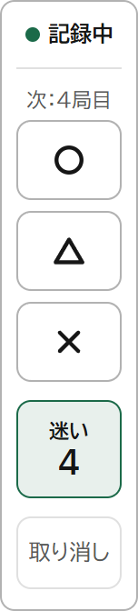
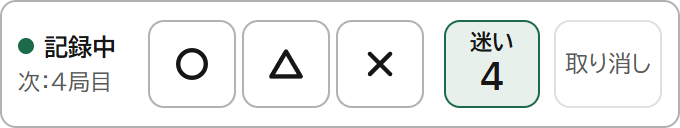
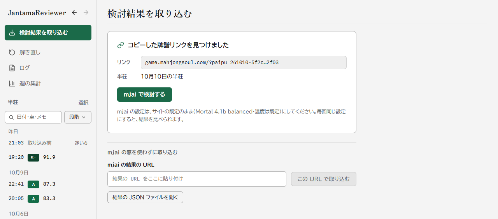
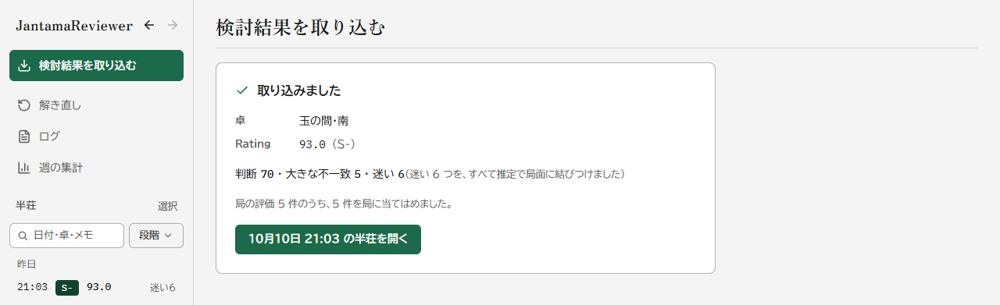
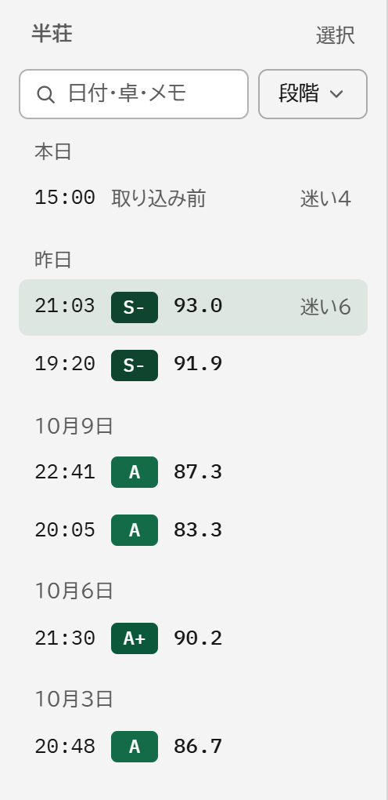
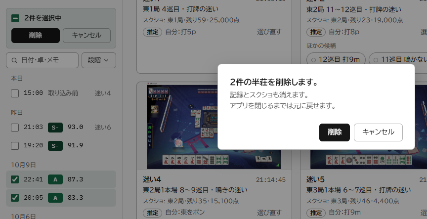
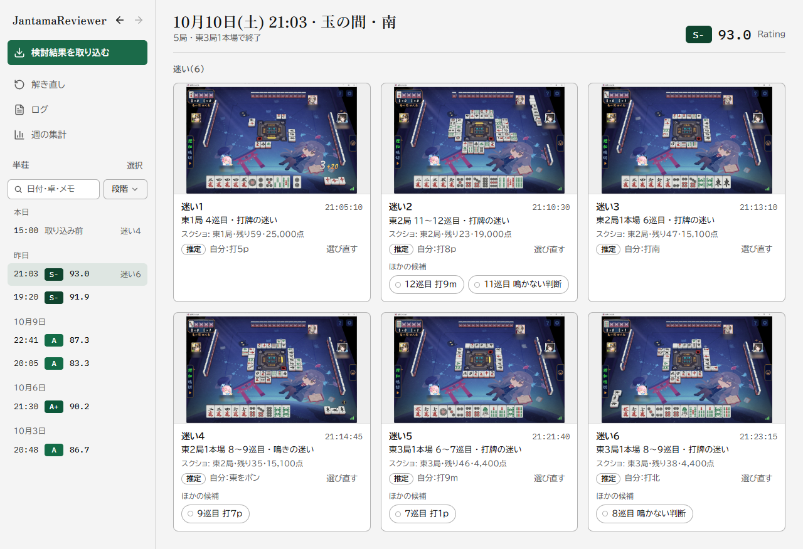
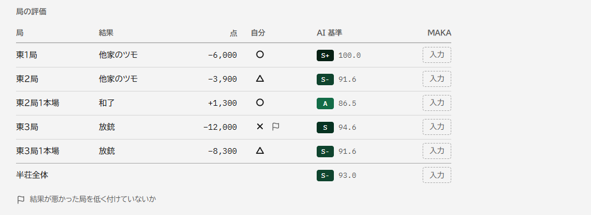
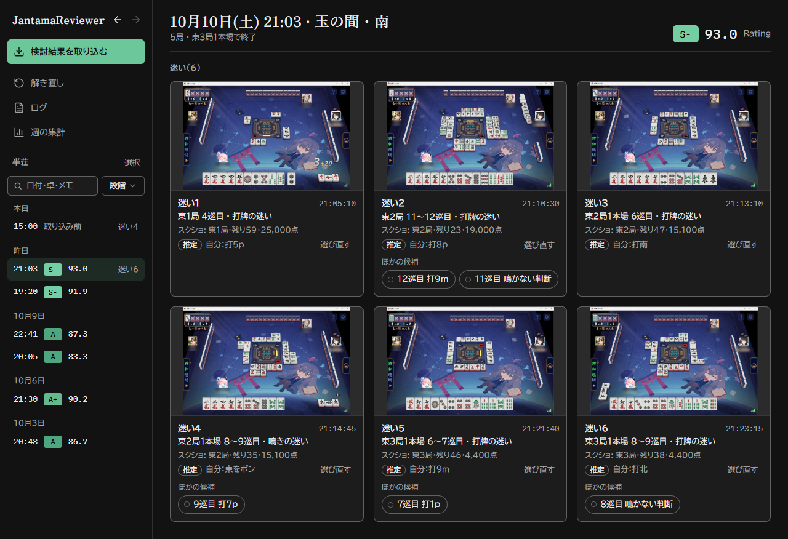
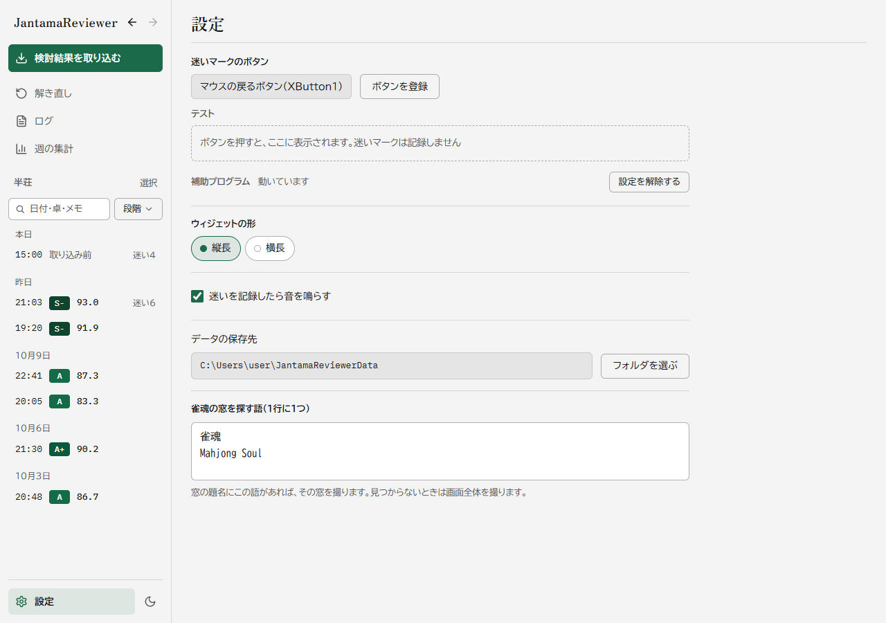

# JantamaReviewer

雀魂の四人麻雀（半荘）を、AI（Mortal）の答えを見る前に自分の答えと理由を確定させてから検討するための、個人用の Windows アプリです。対局中は、小さなウィジェットで「迷った」瞬間と、局ごとの出来（〇△✕）を記録します。対局のあとは、mjai.ekyu.moe の検討結果を取り込み、記録と結びつけて見直します。今できるのは、ここまでです。AI の答えを隠したまま自分の答えを書く出題と、解き直しは、作っているところです（[作っているもの](#作っているもの)）。

## できること

画面の写真は、試験用のデータで撮っています。雀魂の画面は、プレイヤー名をぼかしたものだけを使っています。検討結果は、プレイヤー名を A〜D に置き換えた固定データです。撮り方は `scripts/readme-shots.mjs` にあります。

### 対局中のウィジェット

<p>
  
  
</p>

雀魂の窓の横に置く小さな窓で、常に手前に出ますが、クリックしても雀魂からフォーカスを奪いません。迷ったら、割り当てたボタン（既定はマウスのサイドボタン「戻る」。設定で変えられます）を押すと、その時刻と雀魂の窓のスクリーンショットを保存し（窓が見つからないときは画面全体）、局が終わったら〇△✕でその局の出来を付けます。縦長と横長があり、記録中かどうか、迷いの数、次の評価が何局目かが出ます（「取り消し」で最後の記録を取り消せます）。雀魂が管理者の権限で動いているときは、ボタンを拾う部分だけを、管理者で動く小さな補助プログラム（`jantama-helper.exe`）に分けてあり、設定ページで最初の 1 回だけ Windows の確認を許可すれば、以後は確認なしで起動します。

### 検討結果の取り込み





雀魂で牌譜リンクをコピーしてアプリの窓に戻ると、「この半荘を取り込みますか」と案内が出て、「mjai で検討する」を押すと、アプリの中の小さな窓で mjai.ekyu.moe が開きます（Submit と Cloudflare の確認は自分で押します）。結果が出ると窓は閉じ、結果の JSON を、取り込んだ時点の写しとして保存します（窓が使えないときは、結果の URL を貼るか、JSON ファイルを開いても取り込めます）。取り込みのとき、迷いと評価のスクリーンショットから、局・残りの牌・自分の点数を Windows の日本語 OCR で読み、どの半荘のどの局かを決めます。迷いは、いちばん合う判断を「推定」として結びつけ、近い判断を「ほかの候補」に出し、読めないときは手で選びます。

### 半荘の一覧

<p>
  
</p>



左のサイドバーに、半荘を日付ごとに新しい順に並べ、各行に開始時刻・段階と Rating・迷いの数を出します（段階の印は卓の緑 1 色の濃さで、結果を取り込む前の半荘は「取り込み前」と出ます）。検索欄（日付・時刻・卓・段階・Rating など）と、「段階」の絞り込み（A 以下・B 以下・C 以下）で、半荘を絞れます。削除は、行の「…」から 1 件ずつ、「選択」から複数まとめてでき、確認のあと 8 秒間「元に戻す」が出ます（Ctrl+Z でも戻せます）。消した半荘は、アプリを閉じるまで戻せて、閉じたときに半荘のフォルダが Windows のごみ箱に移ります。

### 半荘の画面







見出しに日時・卓・段階・Rating（Mortal の Rating）が出て、その下に迷いのカードが並びます。カードは、スクリーンショット（押すと大きく表示）、局・本場・巡目と迷いの種類、スクリーンショットから読んだ値、結びつけた判断を持ち、「推定」のものは「選び直す」や「ほかの候補」で付け替えられます（AI の候補や確率は出しません）。「局の評価」の表には、局ごとの結果・点・自分の〇△✕・AI 基準の段階（Mortal の Rating から付けた S+〜E）・MAKA（もう 1 つの検討 AI）の評価（任意で手入力）が並び、AI 基準と大きく食い違う局には旗が付きます。付け直しや選び直しは Ctrl+Z で取り消せ、テーマはサイドバーの下のボタンで、ライトとダークに切り替えられます。

### 設定



迷いマークのボタンの登録（押したマウスのボタンやキーをそのまま覚えます）とテスト、管理者の補助プログラムの設定と解除、ウィジェットの形、音、データの保存先、雀魂の窓を探す語を決めます。変えるとその場で反映して保存します（保存ボタンはありません）。保存先の既定は `%USERPROFILE%\JantamaReviewerData` です。写真は、補助プログラムが動いているときの表示で、保存先は例のパスに置き換えています。

## 作っているもの

- 出題: AI の答えを隠したまま、自分の答えと理由を書いてから答え合わせをします。今日の出題には、迷いを結びつけた局面と、AI と大きく違った局面を出します。
- 解き直し: 間隔を空けて（1・3・7・14・30・60 日）、保存した局面を出し直します。
- 半荘を通して見る画面: 卓の配置で半荘を再生し、迷いの場面や大きな不一致へ飛びます。
- 検索の重ね表示: 半荘と問題を、日付・卓・局などで探します。
- ログ: 答え合わせをした局面の一覧です。
- 週の集計: 差の原因と局面の種類の件数、局の自己評価と AI 基準のずれ、成績（手入力）を見ます。

## 雀魂の規約について

雀魂の規約に触れないよう、次の線引きを守って作っています。これは作者が引いた線引きで、運営者の承認を受けたものではありません。

- 対局中に、ゲームの画面やデータを機械で読み取りません。スクリーンショットは保存するだけです。画像の文字認識（局・残りの牌・点数の読み取り）は、対局後の取り込みのときにしか行いません。
- ゲームの中でスクリプトや拡張機能を動かしません。ゲームの通信を中継せず、ゲームのプロセスにも触れません。
- 対局中に、画面や情報を外部（人や AI）に送りません。
- 対局中に動くのはウィジェットだけです。ウィジェットは、ユーザーの操作（マウスのボタン、クリック）を受けたときに、画面の保存と記録の追記だけを行います。ボタンを拾う補助プログラムは、入力を本体に知らせるだけで、画面・通信・ファイルは扱いません。
- 牌譜リンクを mjai.ekyu.moe に渡すのは、対局後にユーザー自身が行います。Submit も Cloudflare の確認も、自分で押します。アプリが自動で送ることはありません。
- アプリ自身が行う通信は、mjai.ekyu.moe の結果の JSON の取得だけです。mjai の小さな窓は、サイトを開いて見せるだけで、押すのはユーザーです。

このうち、ゲームのプロセスに触れないこと、雀魂のドメインと通信しないこと、対局中に画面を読まないこと、ウィジェットの操作で外へ送らないことは、ソースの静的検査と単体テスト（`apps/desktop/src-tauri/tests/safety.rs` など）で確かめています。基準は `ACCEPTANCE.md` の「安全」の項にあります。

## 動く環境

- Windows 10 / 11（開発と確認は Windows 11 で行っています）
- Microsoft Edge WebView2 ランタイム（画面の表示に使います）
- Windows の日本語の文字認識（OCR）。取り込みのとき、スクリーンショットから局と点数を読むのに使います。入っていなくても取り込みはできますが、迷いの結びつけを、すべて手で選ぶことになります。

## 入れ方と作り方

配布しているインストーラーはありません。ソースから作ります。必要なものは次のとおりです。

- Node.js（動作確認は v25.2.1）と pnpm 11（`packageManager` は `pnpm@11.9.0`）
- Rust 1.90 以上（Windows では MSVC のツールチェーン。Visual Studio の C++ ビルドツールが要ります）
- Microsoft Edge WebView2 ランタイム

```powershell
git clone https://github.com/terasaki-8910/JantamaReviewer.git
cd JantamaReviewer
pnpm install
pnpm --filter @jantama/desktop tauri build --no-bundle
```

`apps\desktop\src-tauri\target\release\` に、本体の `jantama-reviewer.exe` と、管理者の補助プログラムの `jantama-helper.exe` ができます。2 つは同じフォルダに置いておきます。`jantama-reviewer.exe` を起動すると、ウィジェットが出ます。検討画面は、ウィジェットを右クリックして「検討画面を開く」か、タスクトレイのアイコンから開きます。

雀魂が管理者の権限で動いていると、その窓が前面にある間、普通の権限のアプリにはマウスのボタンが届きません。その場合は、設定ページの「管理者の補助プログラムを設定する」を押して、Windows の確認で「はい」を選びます。最初の 1 回だけです。補助プログラムは Program Files に写され、確認なしで起動するタスクが登録されます。「設定を解除する」を押すと、その写しとタスクが消えます。補助プログラムを設定していなくても、管理者ではない窓の上なら、本体だけで動きます。

## 使い方

1. 対局中: 迷ったら、割り当てたボタンを押します。局が終わったら、ウィジェットで〇△✕を付けます。
2. 対局のあと: 雀魂で牌譜を共有（コピー）して、アプリの窓に戻ります。「この半荘を取り込みますか」で「取り込む」を押し、「mjai で検討する」で開く小さな窓で Submit を押します。mjai の設定は、サイトの既定のまま（Mortal 4.1b balanced・温度は既定）にします。毎回同じ設定にすると、結果を比べられます。
3. 取り込みが終わったら、半荘の画面を開きます。迷いのカードの結びつけを確かめ（違っていたら選び直します）、局の評価の表で、自分の〇△✕と AI 基準を見比べます。

データは、半荘ごとのフォルダに保存します（既定は `%USERPROFILE%\JantamaReviewerData\games\<開始時刻>\`）。ウィジェットの記録（`events.jsonl`。追記式）、迷いと評価のスクリーンショット（`marks\`・`ratings\`）、取り込んだ結果（`report.json`）、文字認識の写し（`ocr.json`）、結びつけ（`links.json`）が入ります。保存先は、Git のリポジトリの外に限ります。

## 開発

構成は、Tauri v2 のデスクトップアプリ（`apps/desktop`。画面は React と TypeScript、`apps/desktop/src-tauri` は Rust の本体・`input`・`helper`・`ocr`）と、牌譜の再生や評価の計算を受け持つ TypeScript の `packages/engine` です。

```powershell
pnpm install          # 依存の取得
pnpm test             # 全 vitest と cargo test --workspace
pnpm lint             # eslint・stylelint・tsc・cargo clippy・cargo fmt
pnpm dev              # tauri dev（先に pnpm build:helper で補助プログラムを作っておく）
pnpm build:debug      # デバッグビルド（本体と補助プログラム）
```

- 実機の入力を通す手動の試験は、`pnpm test:hook`（本物のフックに入力を注入）と `pnpm test:task`（本物のタスクスケジューラ）です。`pnpm test` には含めていません。
- 試しに動かすときは、環境変数 `JANTAMA_CONFIG_DIR` に一時フォルダを指定し、そこの `settings.json` の `data_dir` も一時フォルダにします。本物のデータには触れません。
- README の画面写真は、`node scripts/readme-shots.mjs <迷いマークの画像のフォルダ>` で、作った実行ファイルから撮り直せます（一時フォルダだけを使います）。
- 仕様は [SPEC.md](SPEC.md)、受け入れ基準は [ACCEPTANCE.md](ACCEPTANCE.md)、決めたことの記録は [docs/decisions.md](docs/decisions.md) にあります。コード内のコメント・文書・コミットメッセージは日本語で、識別子だけ英語です。

## ライセンス

このリポジトリのコードは、MIT ライセンスです（[LICENSE](LICENSE)）。

ほかの人の作品は、次のように使っています。

- 文字（アプリに同梱）: `@fontsource` のパッケージ 2 つです。どちらも、パッケージの記載のライセンスは SIL Open Font License 1.1 です。
  - IBM Plex Mono（ラテン文字の 400・500）: `@fontsource/ibm-plex-mono` 5.3.0。Copyright 2017 IBM Corp.
  - Zen Old Mincho（ラテン文字の 700）: `@fontsource/zen-old-mincho` 5.3.0。Copyright 2021 The Zen Old Mincho Project Authors (https://github.com/googlefonts/zen-oldmincho)
  - ライセンスの全文は、`pnpm install` のあと、`apps/desktop/node_modules/@fontsource/ibm-plex-mono/LICENSE` と `apps/desktop/node_modules/@fontsource/zen-old-mincho/LICENSE` にあります。
  - 本文の文字は、Windows に入っている書体（BIZ UDPGothic、Yu Gothic UI、Meiryo の順）を使い、同梱していません。
- 牌の画像: [FluffyStuff/riichi-mahjong-tiles](https://github.com/FluffyStuff/riichi-mahjong-tiles)（パブリックドメイン）。いまは確認シート（`docs/sheet/tiles`）で使っていて、アプリでは作っている出題の画面から使います。

そのほかの依存パッケージ（Tauri・React・Rust のクレートなど）は、それぞれのライセンスに従います。`docs/images` の画面写真に写っている雀魂の画面の権利は、それぞれの権利者にあります。

このアプリは個人が作った道具で、雀魂の運営者、Mortal の作者、mjai.ekyu.moe の運営者とは関係がありません。
